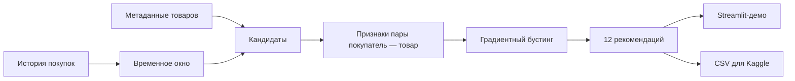

# Архитектура

Генератор кандидатов: 60 популярных артикулов, последние 12 уникальных покупок,
до 12 соседей для каждого из последних 6 артикулов. Граф строится только по
последним 28 дням и максимум 6 событиям каждого пользователя; дуги симметричные.
Это приближённая связь последовательных покупок, не восстановленная корзина.

Признаки: логарифм популярности за 7 и 28 дней, затухание давности повторной
покупки, число покупок, доля категории в последних уникальных товарах покупателя,
вес связи с историей. Модель использует числовые признаки; customer_id и article_id
не являются обучающими признаками. Одинаковые признаки дают одинаковую оценку.

Публичных сервисов и базы с покупателями нет. Raw CSV и сериализованная модель
находятся только в локальных игнорируемых папках. Для демо экспортируются 100
условно обозначенных профилей. Удаление исходных идентификаторов само по себе
не гарантирует анонимность истории; права на публикацию проверяются отдельно.
